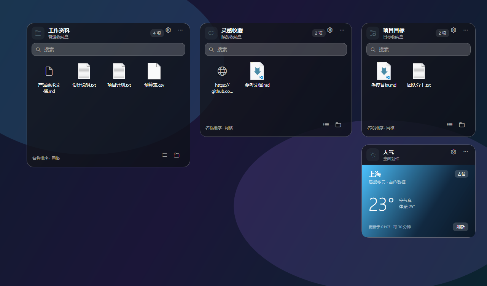
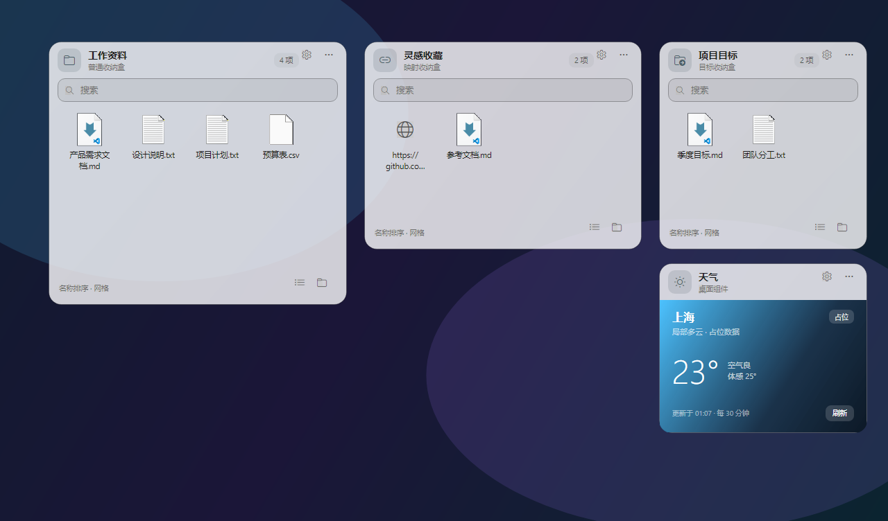
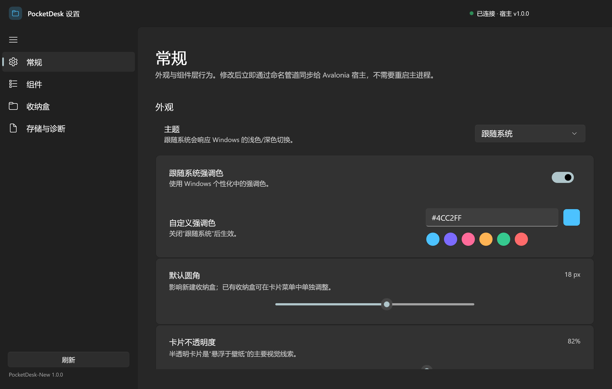
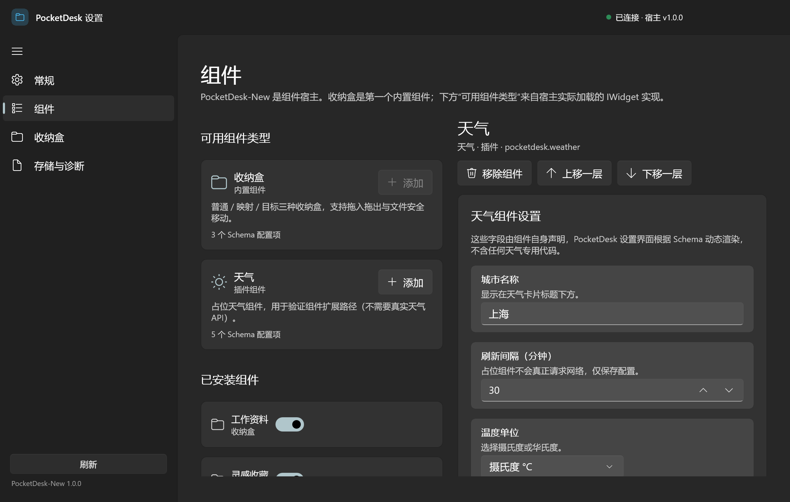
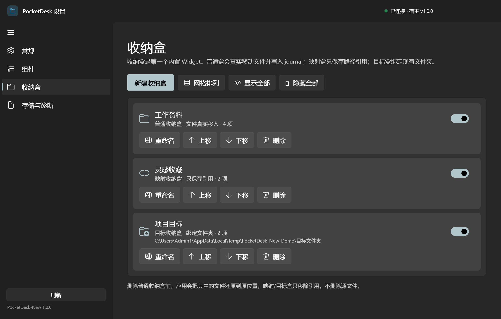
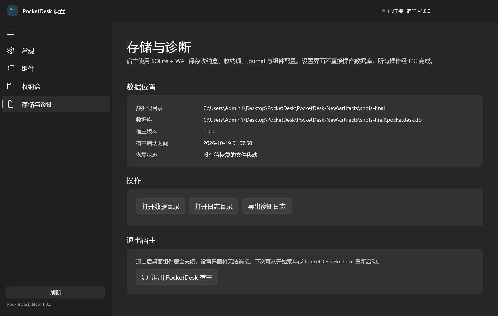

# PocketDesk-New

**悬浮在壁纸上的桌面组件层。收纳盒是它的第一个组件，但不是最后一个。**

PocketDesk-New 用 **Avalonia** 实现透明、无焦点、停靠桌面层的组件宿主，用 **WinUI 3** 实现独立的设置界面，两者通过共享契约 + 命名管道 IPC 协作。它复用了旧版 PocketDesk 的 SQLite / Journal / 文件安全逻辑，但把“多窗口收纳盒”重构成了“一个组件层上的卡片”。

## 1.0.1 更新

- **Win11 Fluent 视觉重做**：卡片改为圆角渐变玻璃、胶囊搜索框、图标徽章、层级化标题/副标题、底部状态栏；按钮补齐 hover / pressed / cursor 状态。
- **修复卡片拖动/缩放漂移**：指针坐标统一使用窗口坐标系，移动/缩放不再因卡片自身位移产生反馈抖动。
- **修复设置打不开**：WinUI 3 发布补齐 `.pri` / `.xbf` 资源；新增卡片标题栏齿轮按钮与 `host.openSettings` IPC，与托盘“打开设置”走同一路径。
- **设置界面 Win11 化**：Mica 背景、自定义标题栏、NavigationView 图标导航、页面卡片留白与滚动修复。
- 版本号提升至 **1.0.1**，重新生成 ARM64 / x64 自包含 MSI。



浅色主题：



## 已实现（M1 / M2 / M3 核心）

- **桌面组件层**：单个无边框透明窗口，覆盖主屏工作区，`WS_EX_TOOLWINDOW` + `WS_EX_NOACTIVATE`，不进入任务栏 / Alt+Tab，默认不抢系统焦点。
- **Win11 Fluent 卡片**：圆角渐变玻璃、图标徽章、胶囊搜索框、底部视图/文件夹操作栏；按钮和收纳项都有明确的 hover / pressed / selected 状态。
- **点击穿透**：`WM_NCHITTEST` 对卡片区域返回 `HTCLIENT`，对卡片之间的透明区域返回 `HTTRANSPARENT`；点击/框选落到桌面或下层应用。
- **视觉冻结 + 按需激活**：所有卡片使用自定义画刷，窗口失去焦点不会变灰；点击搜索框/重命名框时才临时获取系统键盘焦点，获得焦点的卡片顶部显示强调色指示线，Esc/失焦后把焦点交还原应用。
- **桌面层级**：窗口停靠在 Progman/WorkerW 之上、普通应用窗口之下；普通应用最大化时会完整盖住组件层；Win+D 时临时浮起，结束后恢复。
- **卡片布局**：自由摆放、边缘拖拽缩放、位置/尺寸持久化、层级顺序、网格排列。
- **收纳盒 Widget**：普通 / 映射 / 目标三种模式；创建、重命名、删除、图标网格/列表、搜索、右键菜单、排序、拖入、跨卡片拖拽、拖出到资源管理器。
- **文件安全**：普通盒真实移动文件并写 journal；启动时自动恢复未完成移动；同名冲突（保留两者/替换/跳过/取消）；大文件确认；云占位符/UNC/回收站保护；映射盒只存引用；删除时原位还原。
- **组件架构基座**：`IWidget` / `IWidgetContext` / `WidgetSettingsSchema`；内置组件由宿主注册，外部组件从 `Widgets` 目录动态发现；宿主不引用具体组件程序集。
- **占位天气 Widget**：独立程序集 + 独立输出，用来验证“宿主不改代码即可加载新组件”（AC-06）。
- **WinUI 3 设置界面**：Mica 背景 + 自定义标题栏 + NavigationView；常规 / 组件 / 收纳盒 / 存储与诊断四个页面；Schema 驱动动态渲染组件配置；通过命名管道即时同步到宿主。
- **设置入口**：卡片标题栏齿轮、卡片右键菜单、托盘菜单三条路径都可打开设置。
- **托盘与单实例**：打开设置、新建收纳盒、显示/隐藏全部、退出；重复启动会唤醒已有实例。

## 设置界面









设置界面是**独立进程**，只引用 `PocketDesk.Shared` 契约，不引用 Avalonia 宿主程序集，也不直接操作组件层的 UI 对象。

## 快速开始

要求：Windows 10 1809+ / Windows 11、[.NET 10 SDK](https://dotnet.microsoft.com/)。仓库不依赖 Windows App Runtime 预安装（WinUI 3 使用 `WindowsAppSDKSelfContained`）。

```powershell
cd PocketDesk-New

# 构建 + 数据层测试（自动选择 ARM64 / x64）
.\scripts\build.ps1

# 启动演示数据（3 个收纳盒 + 占位天气）
.\scripts\run-host.ps1 -Demo

# 端到端验收（窗口样式、命中测试、焦点、IPC、插件）
.\scripts\verify.ps1
```

手动构建：

```powershell
dotnet build PocketDesk.slnx -p:Platform=ARM64
.\src\PocketDesk.Host\bin\Debug\net10.0\PocketDesk.Host.exe --demo
```

设置界面位于：

```text
src\PocketDesk.Settings\bin\Debug\net10.0-windows10.0.26100.0\win-arm64\PocketDesk.Settings.exe
```

宿主托盘菜单“打开设置”会自动查找它；也可以直接运行。设置界面在宿主未启动时会显示离线提示。

发布：

```powershell
.\scripts\publish.ps1 -Platform ARM64
# 输出 artifacts\publish\win-arm64\
#   PocketDesk.Host.exe
#   Settings\PocketDesk.Settings.exe
#   Widgets\PocketDesk.Widgets.Weather.dll
```

## 安装包（MSI）

```powershell
.\scripts\package.ps1
# 默认构建 ARM64 + x64；也可只构建一个：
.\scripts\package.ps1 -Architectures ARM64
```

输出目录：`C:\Users\Admin1\Desktop\PocketDesk\Pack-new`

```text
PocketDesk-New-1.0.1-ARM64.msi
PocketDesk-New-1.0.1-x64.msi
SHA256SUMS.txt
安装说明-ARM64.txt / 安装说明-x64.txt
```

- 自包含 .NET 10 与 Windows App SDK，目标机无需单独安装运行时。
- 按当前用户安装到 `%LOCALAPPDATA%\Programs\PocketDesk-New`，无需管理员权限。
- 开始菜单创建“PocketDesk-New”和“PocketDesk 设置”两个快捷方式；桌面快捷方式可在安装向导中取消勾选。
- 卸载默认保留 `%LOCALAPPDATA%\PocketDesk-New` 用户数据。
- 未做代码签名，SmartScreen 可能提示。

## 使用方式

- **移动卡片**：拖动卡片标题栏。
- **缩放卡片**：拖动卡片边缘/四角。
- **重命名收纳盒**：双击标题，或右键菜单 → 重命名。
- **搜索**：点击卡片内搜索框；此时卡片顶部出现强调色输入指示线。按 Esc 结束输入并把焦点交还之前的应用。
- **拖入文件**：从资源管理器/桌面把文件拖到卡片上；普通盒移动文件，映射盒只存引用，目标盒移动到绑定文件夹。
- **跨卡片移动**：在组件层内把收纳项拖到另一个同类型收纳盒；不触发系统 OLE 拖拽，避免跨窗口焦点闪烁。
- **拖出文件**：把收纳项拖出组件层窗口，会转为系统 OLE 拖拽，可落到资源管理器。
- **右键菜单**：新建收纳盒/文件夹、粘贴路径、视图、排序、卡片尺寸、打开位置、组件设置、删除。
- **托盘**：打开设置、新建收纳盒、显示/隐藏全部、打开数据目录、退出。

没有收纳盒时，宿主会自动创建“收纳盒 1”；`--demo` 会生成一套隔离的演示数据。

## 组件扩展（AC-06 的关键验证）

`PocketDesk.Widgets.Weather` 是一个**不参与宿主编译引用**的独立程序集：

1. 实现 `PocketDesk.Widgets.IWidget`（`Id`、`DisplayName`、`GetSettingsSchema()`、`CreateView()`）。
2. 构建后 DLL 被复制到 `PocketDesk.Host` 输出目录的 `Widgets\`。
3. 宿主启动时用独立的 `AssemblyLoadContext` 扫描该目录并注册组件。
4. 设置界面通过 IPC 拿到 `WidgetTypeInfo.Schema`，自动渲染“城市名称 / 刷新间隔 / 温度单位 / 体感温度 / 强调色”五个配置项——设置界面里没有任何天气专用代码。

新增一个组件只需要新增一个类库项目 + 把 DLL 放进 `Widgets\`，宿主主界面代码零修改。

## 架构一览

```text
┌──────────────────────────────┐        Named Pipe (JSON lines)        ┌──────────────────────────────┐
│ PocketDesk.Host (Avalonia)   │  <───────────────────────────────>  │ PocketDesk.Settings (WinUI 3)│
│  · single transparent window │       Shared.Contracts + IPC         │  · 常规 / 组件 / 收纳盒       │
│  · WM_NCHITTEST / focus      │                                      │  · Schema 驱动动态配置        │
│  · CardView chrome + Canvas  │                                      │  · 不引用 Avalonia 程序集     │
│  · Widget registry / plugins │                                      └──────────────────────────────┘
└───────────────┬──────────────┘
                │ IWidget / IWidgetContext / WidgetSettingsSchema
     ┌──────────┴───────────┐
     │ BoxWidget (内置)     │   PocketDesk.Widgets.Weather.dll (插件)
     └──────────┬───────────┘
                │
┌───────────────┴──────────────────────────────────────────────────────┐
│ PocketDesk.Core：SQLite + repositories + journal + import/conflict    │
│ PocketDesk.Shared：AppSettings / WidgetInstance / Schema / IPC 契约  │
└──────────────────────────────────────────────────────────────────────┘
```

详细设计见 [docs/architecture.md](docs/architecture.md)，验收矩阵见 [docs/acceptance.md](docs/acceptance.md)。

## 数据与安全

数据目录默认是独立的新目录，避免与旧版 PocketDesk 的 schema / journal 互相干扰：

```text
%LOCALAPPDATA%\PocketDesk-New\
├─ pocketdesk.db          SQLite（WAL，schema v2：boxes/items/journal/settings/widgets）
├─ Storage\<盒Id>\         普通收纳盒真实文件
├─ backup\                迁移前数据库备份（保留 3 份）
├─ Logs\                  诊断日志
└─ Widgets\               用户放置的组件插件（可选）
```

- 设置 `POCKETDESK_HOME` 可以切换数据根目录（便携/测试/截图均使用该变量隔离）。
- 普通盒删除收纳项/收纳盒时先还原文件到原位置；原位置不可用则回退桌面并加 `(restored)`。
- 映射盒绝不移动、复制或修改源文件。
- 删除目标盒内容会进回收站，与资源管理器语义一致。

旧版源码位于 `PocketTset-old/`，仅作参考，不参与新解决方案构建。数据层逻辑（SQLite schema、Journal、冲突策略、路径工具）已迁移到 `PocketDesk.Core`。

## 测试与验收

```powershell
# 数据层：26 个 xUnit 测试
dotnet test tests\PocketDesk.Core.Tests\PocketDesk.Core.Tests.csproj

# 端到端：真实启动宿主，37 项检查
.\scripts\verify.ps1
```

端到端探针实测覆盖：

- 窗口 `WS_EX_TOOLWINDOW` / `WS_EX_NOACTIVATE` / 非置顶 / 启动不抢前台。
- 卡片区域 `HTCLIENT`、卡片间透明区域 `HTTRANSPARENT`。
- `WM_MOUSEACTIVATE` 返回 `MA_NOACTIVATE`，点击卡片背景前台窗口不变。
- 合成点击搜索框后窗口临时激活，Esc 后焦点交还 DSH。
- IPC 快照、组件类型、Schema 字段数、设置即时生效、创建/删除收纳盒、添加/移除天气、Schema 键值持久化、诊断导出、网格排列。

最近一次运行：**37 通过，0 失败**。

## 性能实测

在 Windows 11 ARM64、2560×1600 @ 200% DPI 的测试机上：

| 指标 | 实测 | PRD 目标 | 说明 |
| :--- | :--- | :--- | :--- |
| 冷启动到窗口可见 | 约 2.5–3.7 s | ≤ 1.5 s | 包含 4 张卡片与插件加载；Debug 构建、机器有其他负载 |
| 工作集 | 约 111 MB | ≤ 80 MB | 含共享 DLL 映射 |
| 私有内存 | 约 38 MB | — | 新增一个收纳盒主要增加图标位图与控件 |

启动时间的主要成本是 Avalonia 首帧、组件程序集加载与卡片控件树构建。后续可通过延迟加载非首屏组件、Release/ReadyToRun、图标按需加载进一步优化；当前优先保证交互与数据安全。

## 已知限制

- 天气组件是**占位实现**，不请求真实天气 API；它的价值是验证组件扩展与 Schema 驱动设置路径。
- 多显示器跨屏组件层仅做基础兼容，首期以主屏工作区为准。
- 没有组件商店/在线下载；组件通过代码包 + `Widgets` 目录扩展。
- 拖出到资源管理器依赖系统 OLE 与 Shell，个别第三方文件管理器可能表现不同。
- 设置界面需要 .NET 10 Desktop Runtime 与 Windows App SDK（项目已自包含 Windows App SDK，但未自包含 .NET 运行时）。
- 未做代码签名，SmartScreen 可能提示。

## 目录结构

```text
PocketDesk-New/
├─ PocketDesk.slnx
├─ src/
│  ├─ PocketDesk.Shared/             无 UI 依赖的契约、设置、IPC、Schema
│  ├─ PocketDesk.Widgets.Abstractions/  IWidget / IWidgetContext / WidgetBase
│  ├─ PocketDesk.Core/               SQLite、repositories、journal、导入/冲突、路径工具
│  ├─ PocketDesk.Host/               Avalonia 组件层、Win32 窗口行为、IPC server、托盘
│  ├─ PocketDesk.Widgets.Weather/    占位天气插件（独立程序集）
│  └─ PocketDesk.Settings/           WinUI 3 设置界面
├─ tests/
│  ├─ PocketDesk.Core.Tests/         26 个数据层测试
│  └─ PocketDesk.Verification/       端到端验收探针
├─ scripts/                          build / run-host / verify / publish
├─ docs/                             架构、验收、截图
└─ PocketTset-old/                   旧版源码（只读参考，不参与构建）
```

## License

MIT，见 [LICENSE](LICENSE)。
